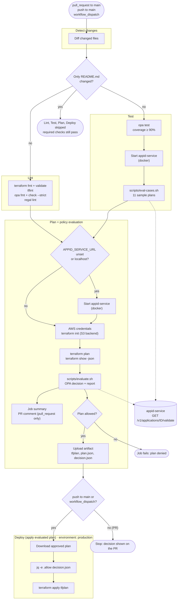

# aws-terraform-opa-guardrails

Policy-as-code guardrails for Terraform on AWS. Every Terraform plan is checked
with [Open Policy Agent](https://www.openpolicyagent.org/) (OPA) before it can be
applied, so non-compliant infrastructure is stopped in the pull request instead
of after it reaches AWS.

## Overview

```
terraform plan ──► terraform show -json ──► opa eval (policies/) ──► allowed? ──► terraform apply
                                               │
                                               └─► appid-service (is the ApplicationID registered?)
```

| Path | What it is |
|---|---|
| [main.tf](main.tf), [variables.tf](variables.tf), [terraform.tfvars](terraform.tfvars) | Sample stack: a KMS key and an S3 bucket with a public access block and SSE-KMS encryption. Mandatory tags are set once through the provider's `default_tags`. |
| [policies/terraform/guardrails/guardrails.rego](policies/terraform/guardrails/guardrails.rego) | The guardrail policy (package `terraform.guardrails`, Rego v1). |
| [policies/terraform/guardrails/guardrails_test.rego](policies/terraform/guardrails/guardrails_test.rego) | OPA unit tests. |
| [tests/](tests/) | Sample plan JSON files, compliant and non-compliant, used for regression tests. |
| [scripts/](scripts/) | `evaluate.sh` (evaluate one plan) and `eval-cases.sh` (run all samples). |
| [appid-service/](appid-service/) | Small Application Registry API used to check that an ApplicationID exists. |
| [.github/workflows/policy.yml](.github/workflows/policy.yml) | CI/CD: lint, test, plan, evaluate and apply. |

## Guardrail rules

The policy produces two outputs:

- **`deny`**: a set of messages. Each one starts with the rule code and the resource address, for example `TAG-002: aws_s3_bucket.this has ApplicationID="APP-1"; ...`.
- **`decision`**: the entry point used by CI: `{"allow": bool, "violations": n, "deny": [{"rule", "resource", "message"}]}`. A plan is allowed only when `deny` is empty.

| Code | Description | What is checked |
|---|---|---|
| **TAG-001** | Mandatory tags | Every resource that supports tags (it has a `tags_all` attribute) must have `ApplicationID`, `Environment`, `Owner`, `CostCenter` and `ManagedBy`. `Environment` must be `dev`, `stg` or `prod`. Tags from the provider's `default_tags` (`tags_all`) are merged with the resource's own `tags`. |
| **TAG-002** | Valid, registered ApplicationID | `ApplicationID` must match `APP-NNNNN` (five digits). IDs in the correct format are then looked up in appid-service (`GET /v1/applications/<id>/validate`). The plan is denied if the service says the ID is not registered, returns an unexpected response, or cannot be reached. Anything other than an explicit `{"valid": true}` counts as a failure. |
| **S3-001** | Block public access | Every `aws_s3_bucket` needs an `aws_s3_bucket_public_access_block` that refers to it, with `block_public_acls`, `block_public_policy`, `ignore_public_acls` and `restrict_public_buckets` all set to `true`. |
| **S3-002** | Default encryption with KMS | Every `aws_s3_bucket` needs an `aws_s3_bucket_server_side_encryption_configuration` that refers to it, with `sse_algorithm = "aws:kms"`. |
| **CHG-001** | Protect production buckets | An `aws_s3_bucket` whose current state is tagged `Environment=prod` must not be deleted or replaced (any change whose actions include `delete`). In-place updates are allowed. |

Notes:

- Resources being destroyed are excluded from TAG-001, TAG-002, S3-001 and S3-002. Resources being replaced are still checked.
- S3-001 and S3-002 link a bucket to its public access block and encryption configuration through the plan's `configuration` section, because the bucket name is not known until apply. This covers resources in the root module that refer to the bucket, such as `bucket = aws_s3_bucket.this.id`.

### Configuration

The policy reads these environment variables when `opa` runs:

| Variable | Default | Purpose |
|---|---|---|
| `APPID_SERVICE_URL` | `http://localhost:8080` | Base URL of appid-service (a trailing `/` is ignored). |
| `APPID_SERVICE_TOKEN` | *(empty)* | When set, sent as `Authorization: Bearer <token>`. |

### Evaluating a plan locally

```bash
terraform plan -out=tfplan
terraform show -json tfplan > plan.json

# Markdown report and decision.json; exit code 0 = allowed, 1 = denied, 2 = evaluation error
scripts/evaluate.sh plan.json decision.json

# Or call OPA directly
opa eval -d policies/ -i plan.json "data.terraform.guardrails.deny"
```

appid-service must be running for TAG-002 (see [appid-service](#appid-service)).

## OPA tests

### Unit tests

[guardrails_test.rego](policies/terraform/guardrails/guardrails_test.rego) has 16 tests and 100% coverage. They use small inline plans and replace `http.send` and `opa.runtime` with mocks, so no registry is needed. They cover:

- **Compliant plans**: allowed, including tags set only at the resource level and in-place updates to a prod bucket.
- **TAG-001**: missing tags and an invalid `Environment`.
- **TAG-002**:
  - a badly formatted ID (denied without calling the service);
  - an unregistered ID;
  - an unexpected response (denied, not allowed);
  - an unreachable service;
  - sending the bearer token, and a missing token rejected by the service.
- **S3-001 / S3-002 / CHG-001**: each violation, with the exact message.
- **`decision`**: the output is split into `rule`, `resource` and `message`.

```bash
opa test policies -v
opa test policies --coverage --threshold 90 --format json | jq '{coverage}'
```

### Regression tests with sample plans

[scripts/eval-cases.sh](scripts/eval-cases.sh) runs `opa eval` on every file in [tests/](tests/) against a running appid-service:

- `tests/compliant/*.json` must produce no violations.
- `tests/noncompliant/<rule>-*.json` must violate only the rule in its file name (for example `tag-002-*.json` → `TAG-002`).

| Sample | Scenario |
|---|---|
| `compliant/dev-create.json` | New dev stack |
| `compliant/stg-create.json` | New stg stack |
| `compliant/prod-update-in-place.json` | In-place tag update on an existing prod bucket |
| `noncompliant/tag-001-missing-tags.json` | Bucket without `Owner` and `CostCenter` |
| `noncompliant/tag-001-invalid-environment.json` | `Environment=staging` |
| `noncompliant/tag-002-invalid-application-id.json` | `ApplicationID=APP-1` |
| `noncompliant/tag-002-unregistered-application-id.json` | `ApplicationID=APP-99999` (correct format, not registered) |
| `noncompliant/s3-001-public-access-block-incomplete.json` | `block_public_policy = false` |
| `noncompliant/s3-001-public-access-block-missing.json` | No public access block |
| `noncompliant/s3-002-sse-not-kms.json` | `sse_algorithm = AES256` |
| `noncompliant/chg-001-prod-bucket-replace.json` | Prod bucket replaced (`["delete", "create"]`) |

```bash
docker build -t appid-service appid-service
docker run -d --rm -p 8080:8080 appid-service
APPID_SERVICE_URL=http://localhost:8080 scripts/eval-cases.sh
```

### Linting

```bash
opa fmt --list --fail policies
opa check --strict policies
regal lint policies
```

## GitHub Actions workflow

[.github/workflows/policy.yml](.github/workflows/policy.yml) runs on pull requests to `main`, on pushes to `main`, and manually (`workflow_dispatch`).



| Job | Runs when | What it does |
|---|---|---|
| **Detect changes** | Always | Skips the remaining jobs when only `README.md` changed. Skipped jobs still satisfy the required checks, so documentation-only PRs can be merged. |
| **Lint** | Something other than `README.md` changed | `terraform fmt`, `terraform validate`, `tflint`, `opa fmt`, `opa check --strict`, `regal lint`. |
| **Test** | Same as Lint | OPA unit tests with the 90% coverage gate, then starts appid-service in Docker and runs `scripts/eval-cases.sh`. |
| **Plan + policy evaluation** | Lint and Test passed | `terraform init` with the S3 backend, `terraform plan`, then `scripts/evaluate.sh`. The Markdown report goes to the job summary and to a PR comment, which is updated on each push. If the plan is allowed, `tfplan`, `plan.json` and `decision.json` are uploaded as an artifact. |
| **Deploy (apply evaluated plan)** | Plan allowed, on a push to `main` or a manual run | Downloads the approved plan, checks `decision.json` again, and runs `terraform apply tfplan`. It never re-plans, so only the plan OPA approved is applied. Uses the `production` environment. |

### Repository settings

| Kind | Name | Used for |
|---|---|---|
| Secret | `AWS_ACCESS_KEY_ID`, `AWS_SECRET_ACCESS_KEY` | AWS credentials for the plan and deploy jobs. |
| Secret (optional) | `APPID_SERVICE_TOKEN` | Bearer token for appid-service. |
| Variable | `TF_STATE_BUCKET` | S3 bucket for Terraform state (`key = guardrails-demo/demo.tfstate`, S3 native locking). |
| Variable (optional) | `APPID_SERVICE_URL` | A shared registry URL. If it is unset or points at `localhost`, the plan job starts its own appid-service container. |
| Variable (optional) | `AWS_REGION` | Defaults to `us-east-1`. |

`main` is protected: changes must go through a pull request, and the Lint, Test and Plan + policy evaluation checks must pass before merging.

Pull requests from forks don't receive the repository secrets and only get a read-only token, so the plan job can't authenticate to AWS or comment on the PR. Open PRs from branches in this repository instead.

## appid-service

A minimal Application Registry API ([app.py](appid-service/app.py)), written with the Python standard library only. TAG-002 uses it to check that an ApplicationID exists.

| Endpoint | Response |
|---|---|
| `GET /healthz` | `{"status": "ok"}` |
| `GET /v1/applications/<id>/validate` | `{"application_id": "<id>", "valid": true \| false}` |

- **Registered IDs:** `APP-00001`, `APP-00002` and `APP-00003` are the only valid IDs. They are hard-coded in `VALID_APPLICATION_IDS`.
- **Unknown paths:** any other path returns `404`.
- **Authentication:** when `APPID_SERVICE_TOKEN` is set, `/v1/...` requires `Authorization: Bearer <token>` and returns `401` otherwise. `/healthz` never requires a token.
- **Docker:** the [Dockerfile](appid-service/Dockerfile) uses `python:3.13-slim`, runs as a non-root user, listens on port 8080, and has a `HEALTHCHECK` on `/healthz`.

```bash
docker build -t appid-service appid-service
docker run --rm -p 8080:8080 [-e APPID_SERVICE_TOKEN=secret] appid-service

curl localhost:8080/healthz
curl localhost:8080/v1/applications/APP-00001/validate
```

In CI, the composite action [.github/actions/start-registry](.github/actions/start-registry/action.yml) builds the image, starts the container on `localhost:8080`, and waits until it reports healthy.
